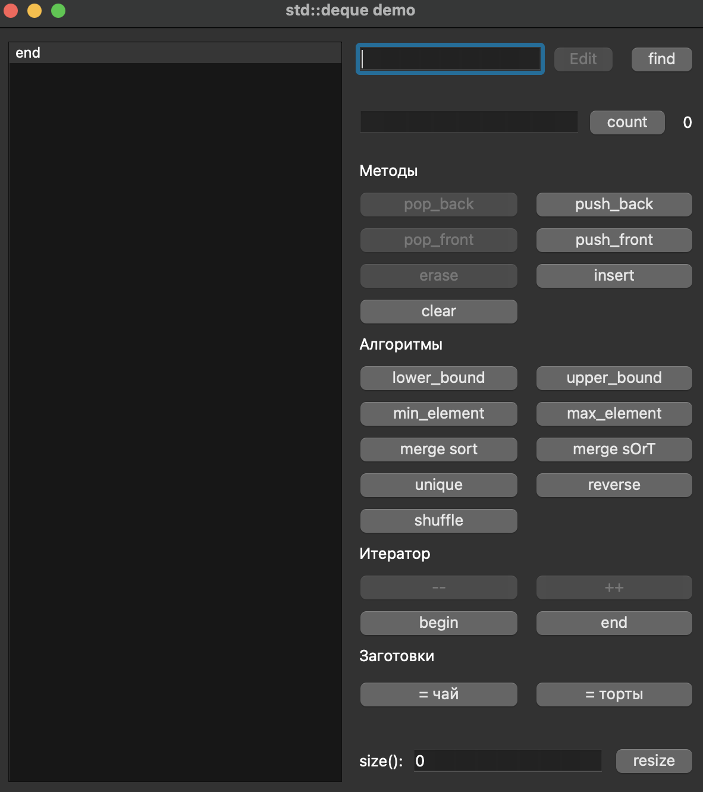

# Deque Emulator

Десктопное приложение на C++20 и Qt Widgets, которое наглядно показывает работу `std::deque<std::string>`: содержимое дека выводится списком с индексами, итератор — выделенной строкой, а методы контейнера и алгоритмы STL вызываются кнопками.



## Возможности

- Методы дека: `push_front`, `push_back`, `pop_front`, `pop_back`, `insert` и `erase` в позиции итератора, `clear`, `resize`.
- Изменение элемента, на который указывает итератор (кнопка `Edit`).
- Управление итератором: `begin`, `end`, `++`, `--`, а также переход на любую строку списка кликом мышью.
- Алгоритмы STL: `find`, `count`, `min_element`, `max_element`, `unique`, `reverse`, `shuffle`, `lower_bound`, `upper_bound`.
- Собственная сортировка слиянием в двух вариантах: `merge sort` (с учётом регистра) и `merge sOrT` (без учёта регистра).
- Проверка корректности перед вызовом: `lower_bound`, `upper_bound` и `unique` срабатывают только на отсортированном деке (`std::is_sorted`).
- Блокировка недоступных действий: например, `++` на `end`, `--` на `begin`, `pop_front` и `erase` на пустом деке.
- Готовые наборы данных для быстрой проверки: `= чай` и `= торты`.

## Интерфейс

| Элемент | Описание |
|---|---|
| список слева | содержимое дека в формате `индекс: значение`, последняя строка — `end` |
| верхнее поле ввода | значение для `push_*`, `insert`, `Edit`, `find`, `lower_bound`, `upper_bound` |
| поле рядом с `count` | значение, вхождения которого нужно посчитать; результат выводится справа |
| поле `size()` | текущий размер дека и новый размер для `resize` (от 0 до 1000) |
| Методы | изменение состава дека |
| Алгоритмы | поиск, сортировка и перестановка элементов |
| Итератор | перемещение итератора |
| Заготовки | заполнение дека готовым набором строк |

## Пример

1. Нажать `= чай` — дек заполнится десятью названиями чая, итератор встанет на `begin`.
2. Нажать `merge sort` — элементы отсортируются по алфавиту.
3. Ввести `Матча` в верхнее поле и нажать `lower_bound` — итератор встанет на первый элемент, не меньший `Матча`.
4. Нажать `++`, затем `erase` — следующий элемент будет удалён, итератор вернётся на `begin`.

## Как устроено

```
Model
├── items     std::deque<std::string>
└── iterator  std::deque<std::string>::iterator
        │
        ▼
MainWindow::ApplyModel()     перерисовывает список и размер
MainWindow::ApplyIterator()  выделяет строку итератора и включает/блокирует кнопки
```

Сортировка слиянием реализована в `algo.h`: `Merge` и `MergeSort` — шаблоны, которые принимают дек любого типа и произвольный компаратор. Сортировка устойчивая и не in-place — возвращает новый дек.

```cpp
model.items = MergeSort(model.items, std::less<std::string>());
```

У `std::deque` сложные правила инвалидации итераторов, поэтому после каждого изменения состава дека (вставка, удаление, сортировка, `resize` и т. д.) итератор ставится на `begin()`. Операции, которые только меняют значения (`Edit`, `reverse`, `shuffle`), положение итератора сохраняют.

## Сборка и запуск

Нужны Qt 6 (модули Core, Gui, Widgets) и компилятор с поддержкой C++20.

Через Qt Creator: открыть `submission.pro`, выбрать комплект сборки (kit) и нажать «Собрать и запустить».

Из терминала:

```bash
qmake submission.pro
make
```

## Структура

```
Deque emulator/
├── algo.h            сортировка слиянием (Merge, MergeSort)
├── model.h           модель: дек и итератор
├── mainwindow.h      окно и слоты кнопок
├── mainwindow.cpp    логика интерфейса
├── mainwindow.ui     разметка окна (Qt Designer)
├── main.cpp          точка входа
└── submission.pro    файл проекта qmake
```

## Технологии

- C++20
- Qt 6 Widgets, Qt Designer, механизм сигналов и слотов
- `std::deque` и его итераторы (random access)
- алгоритмы STL из `<algorithm>`
- шаблонная сортировка слиянием с пользовательским компаратором
- `std::mt19937` для `shuffle`

## Ограничения

- Хранятся только строки (`std::string`), числа сравниваются как строки.
- После любого изменения состава дека итератор сбрасывается на начало, а не сохраняет позицию.
- Размер для `resize` ограничен диапазоном 0–1000.
